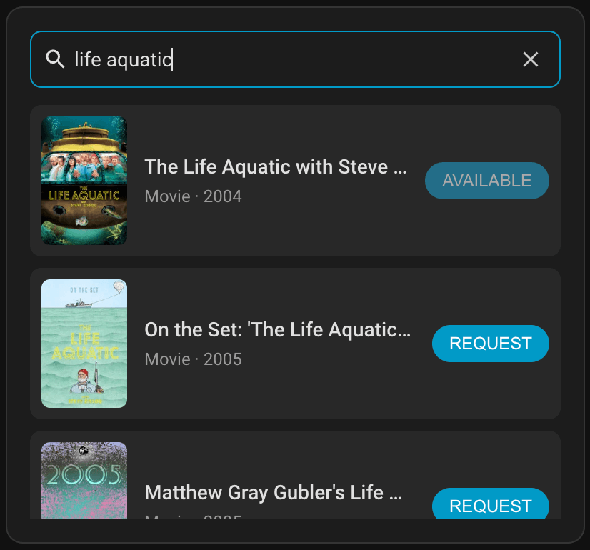
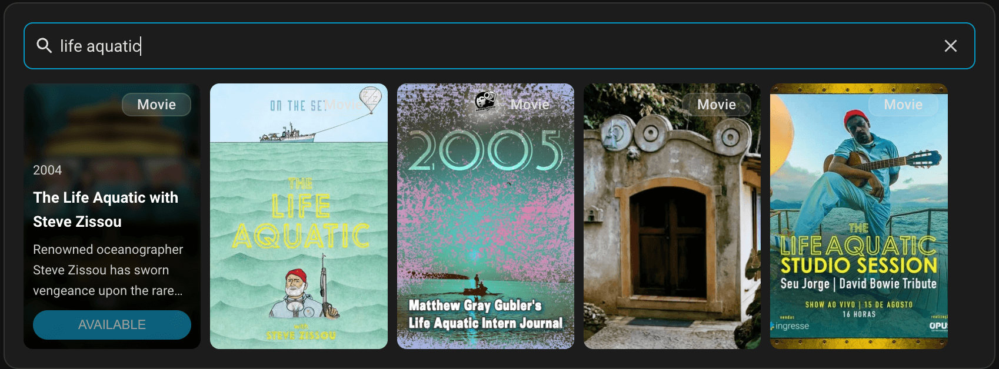

# Seerr Request Card

A custom Home Assistant Lovelace card for searching movies and TV shows and requesting them through the [Seerr (Overseerr)][overseerr-integration] integration — without leaving your dashboard.

[![GitHub Release][releases-shield]][releases]
[![License][license-shield]](LICENSE)
[![GitHub Activity][commits-shield]][commits]

<p align="center"></p>

<p align="center"></p>


---

## Overview

Type a title, get a list of matches, tap **Request**. That's it.

- Live search against your Seerr/Overseerr instance as you type
- Movies and TV shows, with media type and release/first-air year shown
- Poster thumbnails, lazy-loaded, with a choice of size or off entirely (see `show_thumbnails`/`thumbnail_size`)
- Results as a List or a Grid — Grid is a horizontally-scrolling poster carousel whose visible item count grows with card width (see `content_layout`)
- One-tap request, with per-item loading state and a native HA toast on success/failure
- Items already available, pending, or processing in Seerr are shown as such instead of a clickable button
- Visual editor with a proper config-entry picker — no need to hand-type IDs

## Requirements

This card is a frontend companion to the **Seerr** integration built into Home Assistant core — it does not talk to Seerr/Overseerr directly. Set up and configure that integration first: **Settings → Devices & Services → Add Integration → Seerr**. See the [integration docs][overseerr-integration] if you haven't done this yet.

Requires **Home Assistant 2026.11 or newer** — that's when the integration's `search_media` and `request_media` actions (which this card is built entirely on) were added. On older versions the integration exists but this card won't work.

## Installation

### Marketplace (recommended)

[](https://my.home-assistant.io/redirect/marketplace_repository/?owner=willmakenoise&repository=ha_seerr_card&category=plugin)

1. Settings → Marketplace.
2. Search for and install **Seerr Request Card**.

### Custom repository fallback

If you can't find it in Marketplace, add it as a custom repository:

1. Marketplace → **Add from link** (top right).
2. GitHub link: `https://github.com/willmakenoise/ha_seerr_card`.
3. Click install.

### Manual

1. Download `seerr-request-card.js` from the [latest release][releases].
2. Copy it to `<config>/www/seerr-request-card.js`.
3. Add a resource entry (Settings → Dashboards → Resources, or in `configuration.yaml` under `lovelace: resources:`):

```yaml
resources:
  - url: /local/seerr-request-card.js
    type: module
```

## Configuration

Add the card via the dashboard's **Add Card** picker (search for "Seerr Request Card") and use the visual editor to pick your Seerr instance — it's auto-selected if you only have one configured. Or write YAML directly:

```yaml
type: custom:seerr-request-card
config_entry_id: 01JXXXXXXXXXXXXXXXXXXXXXXX
name: Request Something
```

### Options

| Name              | Type   | Required     | Description                                                                 |
| ----------------- | ------ | ------------ | ----------------------------------------------------------------------------- |
| `type`            | string | **Required** | `custom:seerr-request-card`                                                 |
| `config_entry_id` | string | **Required** | The Seerr config entry to search/request against. Pick it via the visual editor, or find it under Developer Tools → Actions → `overseerr.search_media` (switch to YAML mode to see the raw ID). |
| `name`            | string | Optional     | Card header text. No header is shown when unset.                            |
| `content_layout`  | string  | Optional    | `list` (default, "List" in the editor — single-column list) or `grid` ("Grid" in the editor — a horizontally-scrolling poster carousel; title, year, and the Request button only appear on hover/focus, over a blurred poster). Internal values match built-in cards' "Content Layout" option naming. |
| `show_thumbnails` | boolean | Optional    | Show poster thumbnails next to results. Defaults to `true`. Requires Home Assistant 2026.12+ (see below) — degrades to icons automatically on older versions, no need to turn this off just because you're on an older release. |
| `thumbnail_size`  | string  | Optional    | `small` (compact cropped square), `medium` (default, true 2:3 poster aspect ratio, uncropped), or `large`. Only applies to the List layout — Grid tiles always use their own fixed poster size — and only while `show_thumbnails` is on. |
| `show_overview`   | boolean | Optional    | Show a truncated excerpt of each result's description between its title and the Request button. Defaults to `false`. Not available in the List layout while `thumbnail_size` is `small` — too little a visual anchor for a multi-line description. |

## Known limitations

- **Thumbnails and movie release years require Home Assistant 2026.11.1 or newer.** Both come from `poster_path`/`release_date` fields added in [`python_overseerr` 0.10.0][python-overseerr-0.10.0], which HA core only bundles starting with that release. On older versions, results just show a generic movie/TV icon and movies show no year — the same as before, not an error.
- **Requesting already-available media can fail server-side.** Overseerr's request endpoint returns a different response shape for media it already has, which [the client library doesn't parse][python-overseerr-486]. This card avoids calling it for items already known to be available/pending/processing by reading their status from the search results — but if you hit a `MissingField` error in your Home Assistant log regardless, that's this upstream issue, not the card.

## Roadmap
- **Request specific TV-show seasons**. Currently the card will not let you request shows that are partially available in Seerr. Seerr needs to know exactly which seasons you want. Work in progress
- **Want something more?** Create an issue on Github, and I'll look into it.

## Development

### Prerequisites

| Tool    | Version | Notes                 |
| ------- | ------- | --------------------- |
| Node.js | 24      |                        |
| Yarn    | 4       | Managed via Corepack  |

### Quick start

```bash
git clone https://github.com/willmakenoise/ha_seerr_card.git
cd ha_seerr_card
yarn install
yarn start   # watches src/ and rebuilds dist/seerr-request-card.js, serving it at :5001
```

Point a running Home Assistant instance at the dev build as a Lovelace resource (`http://localhost:5001/seerr-request-card.js`, type `module`), or symlink `dist/seerr-request-card.js` into `<config>/www/` and use `/local/seerr-request-card.js`.

A devcontainer (`.devcontainer/`) is also available, which brings up a local Home Assistant instance with the dev build wired in automatically — see `.devcontainer/devcontainer.json`.

### Scripts

| Command      | Description                                          |
| ------------ | ----------------------------------------------------- |
| `yarn start` | Development watcher with hot rebuild                 |
| `yarn build` | Lint, then production bundle (minified)               |
| `yarn lint`  | ESLint across `src/`                                  |

### Project structure

```
src/
├── seerr-request-card.ts   # Card element — search UI, service calls
├── editor.ts                # Visual editor (config-entry picker)
├── types.ts                 # Config + Overseerr response shapes
├── const.ts                 # CARD_VERSION
└── localize/                # i18n strings
dist/
└── seerr-request-card.js    # Build output — this is what HA loads
```

### Releasing

Publishing a GitHub release (tag `vX.Y.Z`) triggers `.github/workflows/release.yml`, which bumps `package.json` and `CARD_VERSION` to match the tag, builds, and attaches `seerr-request-card.js` to the release. HACS installs from that release asset.

---

[commits-shield]: https://img.shields.io/github/commit-activity/y/willmakenoise/ha_seerr_card.svg?style=for-the-badge
[commits]: https://github.com/willmakenoise/ha_seerr_card/commits/master
[license-shield]: https://img.shields.io/github/license/willmakenoise/ha_seerr_card.svg?style=for-the-badge
[releases-shield]: https://img.shields.io/github/release/willmakenoise/ha_seerr_card.svg?style=for-the-badge
[releases]: https://github.com/willmakenoise/ha_seerr_card/releases
[overseerr-integration]: https://www.home-assistant.io/integrations/overseerr/
[python-overseerr]: https://github.com/joostlek/python-overseerr
[python-overseerr-0.10.0]: https://github.com/joostlek/python-overseerr/pull/487
[python-overseerr-486]: https://github.com/joostlek/python-overseerr/pull/486
[card-screenshot]: images/card.png
[card-grid-screenshot]: images/card_grid.png
